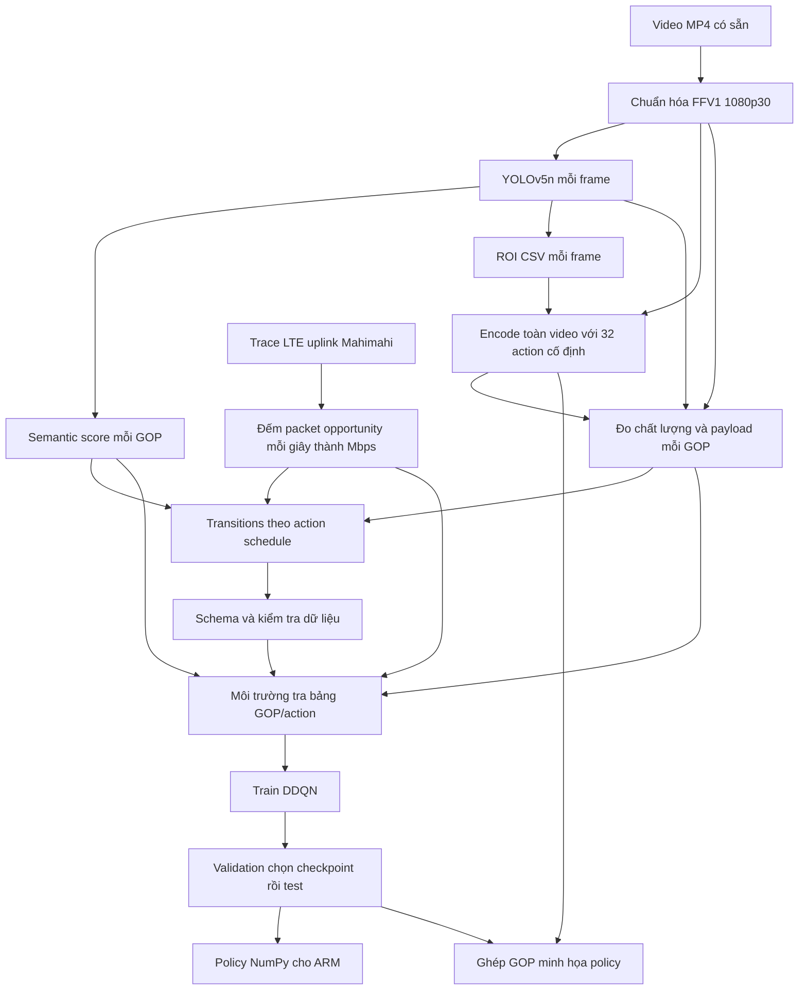

# Giải thích repo và những quyết định khi tự xây dựng

Tài liệu này mô tả implementation đang có trong repo, dựa trên mã nguồn, cấu hình và báo cáo đã lưu. Những đoạn ghi **“khi tự làm”** là phân tích lựa chọn hoặc phần cần xây thêm; chúng không có nghĩa repo đã triển khai phần đó. Các con số kết quả là từ artifact hiện có, không phải một lần chạy lại pipeline khi viết tài liệu.

## 1. Bài toán thực sự là gì?

Repo xây một môi trường mô phỏng bằng dữ liệu để học cách chọn **bitrate mục tiêu và mức ưu tiên chất lượng cho vùng đối tượng** của video giao thông, mỗi giây quyết định một lần. Đầu vào gồm video MP4 và trace băng thông LTE uplink. Đầu ra gồm dataset, policy DDQN, báo cáo đánh giá và video minh họa quyết định của policy.

Một action có hai thành phần:

- Bitrate mục tiêu: muốn encoder tạo ra bao nhiêu Mbps.
- ROI delta-QP: giảm QP bao nhiêu trong vùng có đối tượng. QP thấp hơn thường giữ nhiều chi tiết hơn và có thể cần nhiều bit hơn.

Repo dùng libx264 làm **surrogate**, tức bộ encode thay thế để tạo dữ liệu trước khi triển khai trên VCU thật. README đề cập ZCU106; repo chưa cung cấp vòng điều khiển camera → mạng → VCU trên board.

Các thuật ngữ cần phân biệt:

| Ký hiệu | Nghĩa trong repo | Có đưa vào state không? |
|---|---|---|
| `BW[k]` | Dung lượng đường truyền trong giây k, suy ra từ trace | Chỉ các giây k−4 đến k−1 |
| `target_bitrate_mbps` | Mức bitrate yêu cầu encoder | Không trực tiếp |
| `R_actual[k]` | Bitrate payload H.264 thực sự tạo ra trong GOP k | Giá trị của GOP k−1 |
| `S[k]` | Semantic score, tóm tắt đối tượng trong GOP k | Có |
| ROI | Region of interest, vùng cần ưu tiên | Tọa độ dùng cho encoder, không nằm trong vector state |
| GOP | Group of pictures, ở đây 30 frame = 1 giây | Là đơn vị quyết định |

Điểm quan trọng: bitrate mục tiêu, bitrate thực tế và bandwidth là ba đại lượng khác nhau. Yêu cầu 3 Mbps không đảm bảo mọi giây đều tạo đúng 3 Mbps; mạng có 3 Mbps cũng không đảm bảo GOP vừa tạo được truyền xong đúng hạn.

## 2. Toàn bộ luồng dữ liệu



Có hai nhánh dễ nhầm. `transitions.parquet` là dataset theo một lịch action cụ thể. Nhưng `train()` **không nạp file này để học cố định từ những transition ấy**: nó tương tác với `OfflineGOPEnv`, tra outcome của action được chọn trong grid và tự đưa transition mới vào replay buffer. Schema của transition vẫn được môi trường kiểm tra.

Vì vậy có thể gọi đây là RL trên môi trường surrogate offline có toàn bộ action grid. Nó không phải một implementation batch offline RL chỉ dùng log của một behavior policy.

## 3. Dữ liệu video và môi trường chạy

### 3.1 Video lấy từ đâu?

`video.py` quét tất cả `videos/*.mp4`, dùng tên file không có đuôi làm `video_id`. Workspace hiện có Sample_Video1, NightDrive_dashcam, Highspeed_dashcam, RainyDrive_dashcam và DowntownDrive_dashcam.

Repo không có downloader video, annotation ground truth hay quy trình chứng minh nguồn gốc của các video này. Bước `download` chỉ tải/check model và trace mạng. Muốn thêm video thì tự đặt MP4 trong `videos/`, rồi tái tạo các artifact phụ thuộc.

**Khi tự làm:** phải chọn dữ liệu đại diện cho môi trường mục tiêu: ban ngày, ban đêm, mưa, tốc độ cao, vật thể nhỏ, chuyển động nhanh. Hiện tại split train/validation/test theo **trace mạng**, không theo video: cùng tập nội dung video được dùng trong các split. Kết quả test đo khả năng thích nghi với trace giữ lại, chưa chứng minh tổng quát hóa sang cảnh quay chưa thấy.

### 3.2 Vì sao dùng Docker và pin phiên bản?

`docker/Dockerfile` có ba stage:

1. `media-builder`: build libvmaf v3.0.0, FFmpeg n6.1.1 có libx264/libvmaf và chương trình C++ `roi_encoder`.
2. `pipeline-test`: môi trường kiểm thử media và phần Python thích hợp, không cần chạy YOLO trên GPU.
3. Image chính: PyTorch 2.2.2, CUDA 12.1, torchvision 0.17.2, YOLOv5 v7.0 tại commit `915bbf294bb74c859f0b41f1c23bc395014ea679` và dependencies trong `pyproject.toml`.

`preflight` kiểm tra Docker, CUDA, phiên bản torch/torchvision/CUDA, commit YOLO, biến tắt auto-install, FFmpeg, libvmaf và executable. Pipeline chính yêu cầu NVIDIA GPU, không có CPU fallback cho detector/train/evaluate.

Encode bằng x264 và phần lớn đo metric chạy trên CPU. Có GPU không làm toàn bộ pipeline trở thành encode GPU.

Script `scripts/install_nvidia_container_toolkit.sh` phục vụ cấu hình runtime Docker NVIDIA trên host; README ghi khóa bốn package toolkit ở `1.20.1-1`. Đây là bước cài đặt hệ thống, không phải thuật toán RL.

**Khi tự làm:** chọn môi trường có thể tái lập. Pin này giảm biến thiên do phiên bản, nhưng Dockerfile vẫn có package apt hoặc thành phần không khóa bằng digest tuyệt đối; không nên hiểu là mọi build trên mọi thời điểm đều giống từng byte.

## 4. Chuẩn hóa video: đưa mọi thứ về cùng thước đo

Implementation: `src/vcu_surrogate/video.py`.

Pipeline dùng FFprobe đọc duration, tính:

```text
full_gops = floor(duration × 30 + 1e-6) // 30
keep_frames = full_gops × 30
```

Sau đó FFmpeg:

- Đưa về 30 FPS bằng filter `fps`, có thể bỏ hoặc lặp frame của nguồn.
- Scale trực tiếp về 1920×1080 bằng Lanczos.
- Chuyển pixel format về yuv420p, đặt timestamp theo frame index.
- Bỏ audio và subtitle.
- Giữ số frame là bội số của 30, bỏ phần GOP cuối không đầy.
- Lưu reference `.mkv` bằng FFV1 lossless, GOP 1, gắn thông tin màu BT.709.

FFV1 giữ lossless **so với frame đã chuẩn hóa**, không khôi phục chi tiết mà nguồn MP4 đã mất. Mọi quality metric phía sau so sánh với reference này.

Scale đang ép đúng kích thước, không letterbox giữ tỷ lệ. Nếu video nguồn có tỷ lệ khác 16:9, hình có thể bị kéo. Gắn metadata BT.709 cũng không phải một quy trình quản lý màu đầy đủ cho mọi nguồn HDR hoặc màu khác.

**Khi tự làm:** phải quyết định độ phân giải, FPS, giữ tỷ lệ hay crop, xử lý màu và GOP cuối. GOP một giây làm trace mạng, đo bitrate và quyết định policy dùng chung đơn vị. GOP dài hơn giảm tần suất điều khiển; ngắn hơn tăng overhead keyframe và số quyết định.

Output: `artifacts/reference/<video_id>.mkv`, sidecar JSON và `manifest.parquet` chứa frame/GOP count, đường dẫn và SHA-256.

## 5. YOLO, ROI và semantic score

Implementation: `inference.py`, cấu hình `yolo`.

### 5.1 Detector làm gì?

YOLOv5n dùng weights release v7.0 từ URL trong `assets.py`, được kiểm SHA-256. Model chạy CUDA `cuda:0`, PyTorch backend, FP32, fuse model và chế độ eval. Mỗi frame reference được đọc bằng OpenCV, đổi BGR → RGB, inference size 640 qua AutoShape.

Ngưỡng confidence 0.25, NMS IoU 0.45, tối đa 32 detection. Model được lọc vào tám lớp:

| Lớp | Trọng số |
|---|---:|
| person, bicycle, motorcycle | 1.0 |
| car, bus, truck | 0.8 |
| traffic light, stop sign | 0.7 |

Đây là trọng số do cấu hình lựa chọn, không được học từ ground truth mức quan trọng. YOLO là pretrained detector; repo không fine-tune detector và không đo mAP trên dataset riêng.

**Khi tự làm:** chọn detector theo tốc độ, mức nhớ và khả năng nhận vật thể cần bảo vệ. Ngưỡng thấp có thể tạo thêm ROI sai; ngưỡng cao có thể bỏ sót vật thể. Nano và size 640 là lựa chọn đã có, repo không chứa nghiên cứu so sánh chứng minh chúng tối ưu.

### 5.2 ROI encode khác box metric thế nào?

Mỗi detection có hai bộ tọa độ:

1. Box gốc `x1,y1,x2,y2`: dùng tính diện tích, semantic score và ROI metric.
2. Box `roi_x1,...`: mở rộng 5% chiều rộng/chiều cao về mỗi phía, làm tròn ra ngoài theo lưới 16 pixel, clip trong ảnh; ghi vào CSV cho encoder.

Lưới 16 phù hợp cách tổ chức macroblock H.264. Padding cho thêm vùng quanh đối tượng. Nhiều box có thể chồng lấn; Python không hợp nhất chúng trước khi đưa vào encoder. Không có tracking ID hay làm mượt ROI giữa các frame.

### 5.3 Semantic score được tính chính xác thế nào?

Với detection i trên một frame:

```text
A_i = diện tích box gốc / (1920 × 1080)
mass = Σ class_weight_i × confidence_i × sqrt(A_i)
S_frame = 1 − exp(−mass)
S_GOP = mean(S_frame của 30 frame)
```

Không có detection thì `S_frame=0`. Căn bậc hai giúp vật thể nhỏ có đóng góp lớn hơn so với dùng trực tiếp tỷ lệ diện tích; hàm mũ nén tổng vào [0,1]. Đây là diễn giải của công thức, không phải kết quả ablation có sẵn.

Ví dụ một car confidence 0.9, chiếm 4% ảnh: mass = 0.8×0.9×0.2 = 0.144, score frame khoảng 0.134. Nhiều đối tượng làm score tăng, nhưng từng box vẫn đóng góp vào tổng kể cả khi chồng lấn.

Các feature khác được lưu: count từng lớp, tổng confidence, tổng area fraction và union area. Union area tránh đếm trùng overlap cho `roi_union_fraction`. Count của GOP là tổng count qua các frame: một xe thấy trong cả 30 frame có thể đóng góp 30, không phải 30 xe khác nhau. Các feature ngoài `semantic_score` được lưu trong dataset nhưng DDQN hiện chỉ dùng một score.

**Quyết định thời gian thực chưa giải quyết:** `S[k]` dùng cả 30 frame của GOP k. Muốn biết chính xác score đó trước khi encode cả GOP phải buffer frame và chạy detector trước. Nếu phải quyết định ngay lúc GOP bắt đầu, cần score từ frame đầu, GOP trước hoặc một bộ dự đoán; khi đó nên tạo lại dữ liệu/train theo đúng định nghĩa state mới. Repo hiện chưa mô phỏng latency detector hay buffering này.

Output: detection parquet, GOP semantics parquet, ROI CSV từng video và các bảng tổng tại `artifacts/metadata/`.

## 6. Action space và encode grid

Implementation: `encoding.py` và `cpp/roi_encoder.cpp`.

### 6.1 32 action được đánh số thế nào?

Bitrate có 8 mức `[0.5,1,1.5,2,3,4,6,8]` Mbps. ROI delta có 4 mức `[0,-3,-6,-9]`.

```text
action_id = bitrate_index × 4 + roi_index
```

| Bitrate | ΔQP 0 | ΔQP −3 | ΔQP −6 | ΔQP −9 |
|---|---:|---:|---:|---:|
| 0.5 Mbps | 0 | 1 | 2 | 3 |
| 1 Mbps | 4 | 5 | 6 | 7 |
| 1.5 Mbps | 8 | 9 | 10 | 11 |
| 2 Mbps | 12 | 13 | 14 | 15 |
| 3 Mbps | 16 | 17 | 18 | 19 |
| 4 Mbps | 20 | 21 | 22 | 23 |
| 6 Mbps | 24 | 25 | 26 | 27 |
| 8 Mbps | 28 | 29 | 30 | 31 |

Action 4 là 1 Mbps, delta 0. Action 14 là 2 Mbps, delta −6.

**Khi tự làm:** rời rạc hóa giúp DDQN xuất một trong 32 Q-value và cho phép đo toàn bộ lựa chọn trước. Đổi lại, policy không chọn được bitrate giữa hai mức; số mức càng lớn càng tăng chi phí encode, metric và dung lượng lưu.

### 6.2 Encoder được cấu hình ra sao?

C++ decode reference, chuyển pixel format, thêm ROI side data cho từng frame rồi encode libx264 vào MP4. Python đổi Mbps sang kbps; C++ đổi tiếp sang bit/s theo hệ thập phân.

Cấu hình chính: preset `veryfast`, tune `zerolatency`, H.264 High, một reference frame, không B-frame, GOP cố định 30, min-keyint bằng keyint, không scenecut, không RC lookahead, 6 thread, không sliced threads. VBV max rate bằng bitrate yêu cầu, buffer bằng 3 giây bitrate, mức khởi tạo 0.5, QP min 10/max 51, HRD VBR và không filler.

Không có filler nên cảnh dễ có thể tạo bitrate thấp hơn target. VBV là ràng buộc rate control/buffer của encoder, không mô phỏng hàng đợi truyền mạng.

Delta khác 0 được truyền bằng `AV_FRAME_DATA_REGIONS_OF_INTEREST`, mỗi ROI có `qoffset = delta_qp / 51`. Ý định là giảm QP trong ROI; mức hiệu quả thực tế còn chịu rate control và cách libx264 xử lý ROI. Delta 0 không gắn ROI side data.

### 6.3 Grid được tạo từ toàn video, không reset encoder từng GOP

Cho mỗi video, pipeline encode **32 file toàn video**, mỗi file giữ một action cố định từ đầu đến cuối. Metric sau đó tách outcome theo GOP. Tối đa 8 job encode đồng thời cho một video, mỗi encoder có 6 thread; đây là cấu hình song song hóa, có thể tạo áp lực CPU.

Khi môi trường chọn action 14 ở GOP k, nó tra GOP k của file action 14. File ấy cũng đã dùng action 14 ở các GOP trước. Nếu policy vừa chuyển từ action 4 sang 14, trạng thái VBV/rate control thật có thể khác file grid. GOP bắt đầu bằng keyframe giúp hạn chế phụ thuộc prediction giữa GOP, nhưng không loại bỏ bộ nhớ rate control.

**Khi tự làm:** phải chọn giữa grid nhanh, encode độc lập reset từng GOP, hoặc simulator encoder liên tục với action thay đổi. Repo chọn grid từ các lượt encode action cố định; cần đo domain gap khi dùng policy trên encoder thật.

Output: 32 MP4 mỗi video, sidecar hash, `artifacts/encodes/manifest.parquet` và `action_space.parquet`.

## 7. Đo bitrate và chất lượng

Implementation: `metrics.py`. Tối đa 3 process metric đồng thời; libvmaf bên trong dùng 6 thread.

### 7.1 R_actual lấy như thế nào?

FFprobe lấy `pts_time,size,flags` của packet video. Frame index = round(PTS×30), GOP index = frame_index//30. Với mỗi GOP:

```text
R_actual[k] = Σ packet.size × 8 / (30/30) / 1_000_000 Mbps
```

Đây là tổng byte của packet elementary video do FFprobe báo, chưa cộng chi phí container hay RTP/UDP/IP/Ethernet, retransmission hoặc FEC. Không dùng bitrate trung bình toàn MP4 để thay cho bitrate từng GOP.

`stream_container_overhead_bytes` là kích thước cả file trừ tổng packet bytes **cả file**. Giá trị này được ghi vào các hàng GOP của file, không phải overhead riêng của từng GOP; không được cộng lại qua các GOP.

### 7.2 Chất lượng toàn ảnh

FFmpeg libvmaf so encoded với reference đã chuẩn hóa, đồng bộ timestamp tại 30 FPS. Model `vmaf_v0.6.1`; log có VMAF, PSNR Y và float SSIM từng frame. GOP lấy trung bình metric frame. Thiếu metric bắt buộc thì dừng, không thay thế bằng metric khác.

### 7.3 Chất lượng ROI

OpenCV decode cả hai video về ảnh BGR. ROI PSNR dùng mask hợp của **box gốc**, tính MSE trên pixel và cả ba channel; MSE bằng 0 được quy ước PSNR 100.

ROI SSIM tính cho từng crop box gốc bằng scikit-image, data range 255, cửa sổ tối đa 7 và co nhỏ theo kích thước crop. Trọng số mỗi box là:

```text
class_weight × confidence × diện tích box
```

Lấy trung bình có trọng số theo box trong frame, rồi trung bình các frame có metric trong GOP. Box overlap có thể đóng góp nhiều lần vào SSIM; ROI PSNR dùng union mask nên không đếm pixel overlap hai lần. Crop quá nhỏ có thể không có SSIM hợp lệ; pipeline kiểm tra metric hữu hạn khi GOP có ROI.

Không có ROI thì metric ROI là NaN, `has_roi=False`. Reward dùng ROI quality bằng 0 cho GOP không có ROI. Không tự gán SSIM=1.

**Khi tự làm:** quyết định đánh giá toàn ảnh, vùng quan trọng hay downstream detection. Repo đo VMAF/PSNR/SSIM; nó chưa chạy detector lại trên video nén để đo mức giảm mAP hay khả năng nhận diện. ROI chất lượng hình ảnh cao không tự chứng minh hiệu quả nhận diện tốt.

Output gồm frame metrics, GOP metrics theo action và `artifacts/metrics/gop_action_grid.parquet`, khóa `(video_id,gop_idx,action_id)`.

## 8. Bandwidth: lấy ở đâu, đổi ra sao, dùng lúc nào?

Implementation: `assets.py`, `traces.py`, `rl_env.py`.

### 8.1 Nguồn bw của repo

Bước download clone Mahimahi từ URL cấu hình, checkout detached commit:

```text
f1346c38c415abfc98626dd82450f49a57033603
```

Sáu file `.up` trong `data/raw/mahimahi/traces/` có SHA-256 pin trong code. Download manifest ghi nguồn, commit và hash. `.up` được chọn vì bài toán gửi video **uplink**. Repo sử dụng file trace của Mahimahi/Sprout; không gọi `mm-link` để truyền packet thật trong quá trình train, và không chạy speedtest hay đọc tốc độ card mạng.

### 8.2 File không chứa trực tiếp “Mbps từng giây”

Mỗi dòng là một timestamp nguyên không âm tính bằng mili giây, biểu diễn một cơ hội truyền packet 1500 byte theo quy ước parser. Timestamp phải không giảm; dòng rỗng hoặc không phải số làm bước parse lỗi. Nhiều dòng có cùng timestamp đều được đếm.

Ví dụ:

```text
0
0
500
1500
3000
```

Parser `timestamps//1000` rồi `np.bincount`:

| Giây | Khoảng thời gian | Số event | BW |
|---|---|---:|---:|
| 0 | [0,1000) ms | 3 | 0.036 Mbps |
| 1 | [1000,2000) ms | 1 | 0.012 Mbps |
| 2 | [2000,3000) ms | 0 | 0 Mbps |
| 3 | [3000,4000) ms | 1 | 0.012 Mbps |

Công thức:

```text
BW[k] = count(timestamp thuộc giây k) × 1500 × 8 / 1_000_000
```

Không nội suy, không smoothing, không bỏ giây mất mạng. Bắt đầu đếm từ giây 0 kể cả khi event đầu tới muộn. Độ dài là floor(timestamp cuối/1000)+1; giây cuối vẫn chia cho một giây đầy đủ, không chỉnh mẫu số theo thời gian của event cuối. Parser không suy ra phần thời gian sau timestamp cuối.

**Khi tự làm:** kích thước packet quy ước, cách chia bin, giữ outage và xử lý giây cuối đều ảnh hưởng phân phối bw. Thay cửa sổ một giây bằng 100 ms sẽ thay đổi state/reward và cần đồng bộ với đơn vị quyết định mới.

### 8.3 Chia train/validation/test

| File | Vai trò |
|---|---|
| `ATT-LTE-driving.up` | Train |
| `TMobile-LTE-driving.up` | Train |
| `ATT-LTE-driving-2016.up` | Validation |
| `Verizon-LTE-driving.up` | Test |
| `TMobile-LTE-short.up` | Excluded, chỉ catalog |
| `Verizon-LTE-short.up` | Excluded, chỉ catalog |

File short bị loại để tránh nguy cơ trùng với trace dài. Split được hardcode trong `TRACE_SPLITS`; `split_seed` **không random chia lại các trace**. Seed đó được dùng tạo lịch action của dataset transition.

Output `bandwidth_traces.parquet` có trace/source/split, `gop_idx`, thời gian đầu/cuối giây, Mbps. `trace_catalog.parquet` chứa cả sáu file, hash, duration và thống kê.

### 8.4 Policy có biết bw hiện tại trước khi quyết định không?

Không. Trước action ở GOP k, state chứa bốn cửa sổ **đã hoàn tất**:

```text
[BW[k−4], BW[k−3], BW[k−2], BW[k−1], R_actual[k−1], S[k]]
```

`BW[k]` chỉ được dùng để tính reward sau action. Có cột `bw_mbps` trong transition không có nghĩa cột ấy được đưa vào mạng Q. Sau step, history trượt thêm BW[k].

Bốn GOP đầu luôn action 4 để thu đủ lịch sử và bitrate GOP trước. Warm-up không được đưa vào replay và không tính trong return đánh giá policy. Warm-up vẫn xuất hiện trong video render.

### 8.5 Trace synthetic được tạo thế nào?

Mỗi block 10 episode train có đúng 7 episode trace thật và 3 episode synthetic, xáo trộn thứ tự. Đây là tỷ lệ **episode**, không bảo đảm chính xác tỷ lệ transition vì video dài ngắn khác nhau.

Episode thật chọn video, train trace và offset ngẫu nhiên sao cho đủ chiều dài video. Synthetic ghép các đoạn 10 giây lấy ngẫu nhiên chỉ từ ATT/T-Mobile train, cắt tới chiều dài yêu cầu. Ghi lineage trace và offset từng block để truy nguyên. Synthetic không phải bw random độc lập hay trace tạo từ validation/test; điểm nối block có thể tạo bước nhảy không tự nhiên.

### 8.6 Nếu tự triển khai thì phải đo bw ra sao?

**Phần này chưa có trong repo.** Cần một adapter cung cấp bốn mẫu Mbps đúng thứ tự, đúng cửa sổ đã hoàn tất và gần đúng ý nghĩa capacity của trace.

Phải xác định đang đo đại lượng nào:

- Byte encoder tạo ra: đó là `R_actual`, không đo capacity mạng.
- Byte ứng dụng gửi đi: có thể nằm trong buffer hệ điều hành, chưa chắc receiver nhận được.
- Byte receiver nhận được hoặc được ACK: đo delivered throughput; nếu ứng dụng chỉ gửi 1 Mbps trong khi link chịu 10 Mbps, số đo thường không thể tự cho biết capacity là 10 Mbps.
- Ước lượng bandwidth bằng probing hoặc feedback transport: có thể cung cấp ước lượng capacity, nhưng cần xử lý nhiễu, chi phí probe và độ trễ phản hồi.

Quy trình tích hợp có thể là: chốt một giây theo đồng hồ monotonic → lấy byte đã nhận/ACK hoặc estimator → quy đổi `bytes×8/elapsed/1e6` → đưa vào history → quyết định cho GOP tiếp theo. Đây là đề xuất thiết kế, không phải hàm có sẵn.

Cần quyết định byte tính gồm overhead nào, cách xử lý ACK muộn, sample thiếu và outage. Sample không đo được không tự động tương đương bandwidth bằng 0. Nếu state triển khai là throughput bị giới hạn bởi action mà training dùng capacity trace độc lập action, có domain gap; nên tạo/train theo estimator triển khai hoặc kiểm chứng sai lệch trước.

## 9. Transition dataset và quan hệ nhân quả

Implementation: `transitions.py`.

Mỗi video ghép với mỗi trace được sử dụng. Episode của bước này bắt đầu tại trace offset 0, horizon = min(số GOP video, số giây trace). Cần ít nhất 6 GOP. Đây là cách tạo dataset; train env dùng offset ngẫu nhiên còn evaluation dùng nhiều offset xác định.

Lịch mặc định ghép các permutation ngẫu nhiên của 32 action để có coverage, rồi ép bốn action đầu bằng 4. Vì ép warm-up sau khi tạo permutation, block đầu không còn bảo đảm chứa đủ mỗi action một lần. Seed episode lấy từ hash của base seed, video ID và trace ID để có thể tái tạo.

Có thể đưa CSV `video_id,trace_id,gop_idx,action_id`. Pipeline yêu cầu đầy đủ chính xác tất cả horizon, không duplicate, action hợp lệ và warm-up đúng. Không chấp nhận schedule thừa/thiếu.

Với k từ 4 đến cuối:

1. Lấy state với bandwidth quá khứ và outcome của **action thực sự chọn ở GOP k−1**.
2. Tra grid outcome của action hiện tại ở GOP k.
3. Tính reward bằng BW[k].
4. Tạo next history trượt một giây, next previous bitrate bằng R_actual[k], next semantic bằng S[k+1].
5. GOP cuối có `done=True`; next semantic và `next_bw_mbps` bằng 0, nhưng next history và next previous bitrate vẫn được lưu. DDQN không bootstrap khi done.

Dataset còn lưu metric, các thành phần reward, target error và outage (`BW<0.05`). `target_error_fraction` chỉ để phân tích, không nằm trong reward.

Output: `transitions.parquet`, `action_schedules.parquet`, `transition_schema.json`.

## 10. Reward: đang tối ưu chính xác điều gì?

Implementation: `reward_for()` trong `rl_env.py`. Đặt R là bitrate thực, B là bandwidth, i/j là chỉ số bitrate/ROI:

```text
ratio = R / max(B, 0.05)
violation = min(max(0, ratio−1)^2, 4)
utilization = min(ratio, 4)
switch = 0.5 × (abs(i−i_prev)/7 + abs(j−j_prev)/3)
q_full = VMAF / 100
q_roi = ROI_SSIM nếu GOP có ROI, ngược lại 0

reward = 0.45×q_full + 0.25×q_roi
         − 0.20×violation
         − 0.05×utilization
         − 0.05×switch
```

Các trọng số là lựa chọn cấu hình; repo không có optimizer tự tìm trọng số tối ưu.

- VMAF khuyến khích chất lượng toàn ảnh.
- ROI SSIM khuyến khích chất lượng vùng đối tượng.
- Violation phạt vượt bandwidth bằng bình phương tỷ lệ vượt, có cap.
- `bandwidth_utilization` được **trừ**: nó là chi phí dùng bandwidth, không phải bonus cố dùng đầy link.
- Switch phạt thay đổi chỉ số action, không phải độ chênh Mbps trực tiếp. Ví dụ bước 0.5→1 và 6→8 đều cách một index.

Epsilon 0.05 tránh chia cho 0 khi mất mạng; cap hạn chế penalty rất lớn. Reward không phạt trực tiếp delay, packet loss hay queue vì môi trường chưa mô hình hóa các đại lượng này. Không có ROI cũng không được phân phối lại trọng số 0.25 sang VMAF.

Ví dụ VMAF=80, ROI SSIM=0.9, R=2 Mbps, B=1 Mbps, không switch: reward = 0.36+0.225−0.20−0.10 = 0.285. Vượt bandwidth vẫn có thể có reward dương; cấu hình không đặt ràng buộc cứng R≤B.

**Khi tự làm:** quyết định chất lượng so với độ trễ/tiết kiệm mạng, cách xử lý outage, tiêu chuẩn ổn định action và có cần hard constraint. Metric được lưu trước reward nên đổi trọng số có thể tính lại reward và train lại mà không encode lại nếu grid không đổi.

Một hạn chế state đáng chú ý: reward switch phụ thuộc action trước, nhưng state chỉ có bitrate thực trước, không có `previous_action_id` hoặc ROI index trước. Agent không quan sát đầy đủ biến dùng tính reward; cùng R_previous có thể đến từ các action khác nhau. Bốn mẫu bw cũng không đảm bảo mạng là Markov. Muốn state đầy đủ hơn phải cân nhắc thêm action trước, queue hoặc history khác rồi sửa schema/model/export tương ứng.

## 11. Môi trường RL và chuẩn hóa state

`GridDataset` kiểm tra schema GOP30/30 FPS/32 action, action table, catalog hash, processed trace khớp raw, grid đủ tất cả action, metric hữu hạn và GOP có 30 packet/1 key packet.

`OfflineGOPEnv.reset()` chọn một video và đoạn trace dài bằng video, chạy warm-up bằng tra grid, bắt đầu quyết định tại k=4. `step(action)` tra outcome, tính reward, đặt outcome thành previous rồi tăng k. Kết thúc khi hết video; next observation là vector 0, terminated=True, truncated=False.

Không có socket, hàng đợi, simulator RTT hoặc truyền packet thật trong step. Bandwidth trong episode không thay đổi do action; action chỉ tác động reward và `R_previous` của state kế tiếp, trong khi outcome encode vẫn lấy từ grid.

Chuẩn hóa:

```text
normalized = clip((raw−mean)/std, −10, 10)
```

Mean/std cho bốn feature bw lấy từ toàn bộ trace **train**. Mean/std của R_actual lấy từ toàn grid; semantic lấy từ toàn tập video. Vì split theo trace và video dùng chung, đây không phải chuẩn hóa trên một tập video train riêng. Các vector normalizer được export theo policy và phải dùng lại khi triển khai. `NumpyPolicy` nhận **raw state**, tự chuẩn hóa; không chuẩn hóa trước lần nữa.

## 12. DDQN học như thế nào?

Implementation: `ddqn.py`.

Mạng Q: `6 → Linear128 → ReLU → Linear128 → ReLU → Linear32`. Mỗi đầu ra ước lượng discounted return của một action, không trực tiếp dự đoán bitrate hay bandwidth.

Train ba seed 13, 29, 47, mỗi seed 300.000 step quyết định, mỗi step là một GOP sau warm-up. Mỗi lần gọi train khởi tạo mạng và replay mới.

| Tham số | Giá trị | Tác dụng |
|---|---:|---|
| Replay capacity | 100.000 | Buffer vòng chứa transition agent đã đi qua |
| Learning starts | 2.000 | Thu dữ liệu trước khi bắt đầu update |
| Batch | 64 | Sample ngẫu nhiên từ replay, có thể lặp index |
| Optimizer | Adam, lr 0.001 | Cập nhật online network |
| Gamma | 0.99 | Trọng số reward tương lai |
| Target sync | 1.000 step | Copy online sang target |
| Exploration | gần 1 giảm tuyến tính xuống 0.05 trong 50.000 step | Epsilon-greedy |
| Loss | Smooth L1/Huber | So Q action chọn với target |
| Gradient clipping | Norm 10 | Giới hạn gradient |
| Validation | mỗi 5.000 step | Chọn checkpoint |

Double DQN target:

```text
a_best = argmax_a Q_online(next_state,a)
y = reward + gamma × (1−done) × Q_target(next_state,a_best)
```

Online network chọn action tốt nhất, target network đánh giá action đó. Mỗi step sau learning-start thực hiện một update; target khởi tạo giống online. Seeds cho Python/NumPy/torch/CUDA được đặt, cuDNN deterministic bật và benchmark tắt.

**Khi tự làm:** DDQN hợp action rời rạc; repo không có PPO/SAC hay so sánh thuật toán. Replay, mạng và exploration đều là quyết định cần kiểm chứng bằng validation, learning curve và baseline, không chỉ bằng việc loss chạy được.

Checkpoint `.pt` lưu online/target, optimizer, normalizer, config, seed, step, validation score và nhiều RNG state. Nhưng **chưa có resume training**: không lưu đầy đủ replay contents/current episode/mix block và train không load checkpoint để tiếp tục. Không nên hiểu ghi RNG đồng nghĩa resume chính xác.

## 13. Validation, test và cách đọc kết quả

### 13.1 Dataset validation

`validate_dataset()` kiểm tra artifact cần thiết, count, khóa không trùng, đủ 32 action/GOP, metric hữu hạn, split trace, transition action/done và previous bitrate khớp lịch action. FFprobe kiểm tra mỗi frame đầu GOP là key/I, các frame còn lại là P. `GridDataset` bổ sung kiểm tra contract và trace nguồn.

Kiểm tra frame type này không thay thế toàn bộ một phép phân tích bitstream chuyên sâu. Validation passed nghĩa dữ liệu qua các điều kiện code đặt ra; không có nghĩa chất lượng policy đã tối ưu hoặc đủ điều kiện thời gian thực.

Báo cáo có sẵn: 5 video, 8.820 frame, 294 GOP, 32 action, 9.408 grid row, 6 trace trong catalog, 1.096 transition; `status=passed`, thiết bị ghi nhận Quadro T1000.

### 13.2 Đánh giá policy dùng episode nào?

Validation dùng ATT 2016, test dùng Verizon. Mỗi video được ghép với các đoạn trace **không chồng nhau cho riêng video đó**: offset 0, L, 2L… với L là số GOP video, chỉ lấy đoạn đủ dài. Các video khác nhau vẫn có thể dùng thời gian trace chồng nhau. Evaluation không dùng synthetic và không exploration.

Mỗi seed lưu checkpoint khi **mean validation episode return** tăng. Sau train chọn seed tốt nhất trên validation. Test đánh giá cả ba seed và báo mean/std qua seed, không chọn seed theo test.

Mean return là trung bình **tổng reward episode**, không phải reward/GOP. Video dài có thể tạo return lớn hơn; còn mean VMAF/bitrate/violation tính trên các row rollout, nên weighting khác mean return. `std_return` đo biến thiên episode; `test_aggregate.std` đo biến thiên giữa ba seed, không phải confidence interval.

Warm-up bị loại khỏi metric rollout. Violation rate đơn giản là tỷ lệ GOP `R_actual>BW`, khác penalty bình phương có epsilon/cap. Action-switch rate tính cả quyết định đầu sau warm-up so với action warm-up.

### 13.3 Báo cáo hiện có nói gì?

Theo `reports/rl/evaluation_summary.json`, policy được chọn là seed 13, checkpoint step 240.000, validation mean return khoảng 10.870. Trên 161 episode test: VMAF khoảng 73.431, ROI SSIM 0.9231, bitrate thực trung bình 3.2595 Mbps, violation rate 21.75%, switch rate 55.77%, mean return 15.878.

Seed 29 có test mean return khoảng 16.041 cao hơn seed 13, nhưng vẫn không được chọn vì validation seed 13 tốt hơn. Đây là hành vi đúng với quy tắc selection đang dùng.

Các file `reports/rl/` cũ không chứa baseline cố định bitrate, heuristic theo bw hay oracle để so sánh. Bộ benchmark bổ sung trong `benchmark.py` nay thực hiện các đối chiếu này, cùng metric non-ROI và bảo toàn detection; xem [hướng dẫn benchmark](BENCHMARK.md) và kết quả sau khi chạy tại `reports/benchmark/REPORT.md`. Vẫn chưa có kiểm chứng trên VCU thật hay cảnh quay độc lập.

## 14. Export policy để chạy ARM

`evaluate()` export `.npz` cho từng seed, so Q-value và argmax NumPy với PyTorch trên state của test rollout: max Q error phải ≤1e−5 và action phải khớp. Báo cáo hiện có ghi error 0.0. `export-policy` export policy seed được chọn thành `artifacts/rl/ddqn_selected.npz`.

File NPZ chứa weights/bias ba linear layer, normalizer, action table, state columns, FPS/GOP và warm-up contract. `policy_numpy.py` chỉ cần NumPy, kiểm schema và shape, chạy matrix multiply/ReLU rồi argmax.

Ví dụ sử dụng sau khi có file export:

```python
import numpy as np
from vcu_surrogate.policy_numpy import NumpyPolicy

policy = NumpyPolicy("artifacts/rl/ddqn_selected.npz")
# Ví dụ raw state, không phải mẫu đo mạng thật:
state = np.array([2.0, 2.3, 1.8, 1.5, 1.2, 0.4])
action_id, bitrate_mbps, delta_qp = policy.act(state)
```

Module này cho phép suy luận Q trên ARM nhưng **không tự điều khiển VCU, chạy YOLO, đo bw, gửi video hoặc thực hiện warm-up**. Ứng dụng bên ngoài phải làm các việc đó. Sao chép riêng module NumPy và NPZ có thể tránh phụ thuộc stack training; cài toàn package vẫn có dependencies rộng hơn NumPy.

## 15. Render policy video: xem được điều gì?

`render.py` đọc test rollout của seed được chọn, lấy riêng Verizon offset 0 cho từng video. Nó thêm bốn action warm-up rồi tạo playlist ffconcat. GOP k lấy khoảng `[k,k+1)` từ file encode của action được chọn, FFmpeg ghép bằng `-c:v copy`, không encode lại. Sau ghép kiểm frame count và pattern key/I/P, lưu MP4, action list và hash.

Video này cho thấy hình ảnh theo lựa chọn offline. Nó không thể hiện packet loss, buffering, delay mạng hay lỗi truyền khi R vượt B. Nó cũng không phải video đã encode liên tục với rate control đổi theo action. Mỗi đoạn lấy từ lượt encode toàn video với action cố định; xem video không đủ để đánh giá tính ổn định VBV khi switch thật.

## 16. Cách chạy và lần theo artifact

Chạy từ thư mục gốc trên host có Docker/NVIDIA runtime phù hợp:

```bash
make build
make preflight
make all
```

`make all` lần lượt preflight → download → normalize → infer → encode → metrics → traces → transitions → validate → train → evaluate → render-policy. Evaluate đã gọi export policy được chọn, nên `all` không cần target export riêng.

Để chạy từng giai đoạn:

| Lệnh | Input chính | Output chính |
|---|---|---|
| `make download` | URL/commit/hash pin | Weights, raw traces, download manifest |
| `make normalize` | `videos/*.mp4` | Reference lossless và manifest |
| `make infer` | Reference + weights | Detection, ROI CSV, semantics |
| `make encode` | Reference + ROI | 32 encode/video và action table |
| `make metrics` | Encode + reference + detection | Frame metrics và GOP/action grid |
| `make traces` | Raw `.up` | BW theo giây và catalog |
| `make transitions` | Grid + semantics + BW | Transition, schedule, schema |
| `make validate` | Dataset và encode | Validation report |
| `make train` | Grid + semantics + traces + schema | Best checkpoint từng seed, learning logs |
| `make evaluate` | Checkpoint và dataset | Rollout, summary, NPZ và selected policy |
| `make export-policy` | Selected seed + checkpoint | `ddqn_selected.npz` |
| `make render-policy` | Selected test rollout + encodes | Policy MP4 |

Makefile chạy container với user UID/GID host, bind mount repo tại `/workspace`, HOME trong container là `/tmp`, IPC host. Các target cần CUDA dùng `--gpus all`; các bước khác dùng container thường. Python mặc định ROOT là `/workspace`; chạy trực tiếp ở host phải đặt `VCU_PROJECT_ROOT` đúng, nhưng pipeline chuẩn vẫn dùng Docker và preflight yêu cầu Docker.

Chạy schedule tùy chỉnh theo ví dụ README bằng subcommand `transitions --schedule <CSV>`. CLI nhận `--config` trước subcommand; subcommand encode tên `encode-grid`, tương ứng `make encode`.

**Không dùng `make -j all`** với Makefile hiện tại: các giai đoạn được liệt kê thành prerequisite của `all`, chưa có dependency graph chi tiết buộc từng bước đợi input. Chạy song song có thể khiến metrics/encode/train đi trước dữ liệu của chúng. Nếu cần orchestration song song, phải khai báo dependency hoặc dùng CLI `all` tuần tự.

### Resume và hash có giới hạn gì?

Normalize/inference/encode/metrics/render có cache hoặc sidecar job hash theo input/config liên quan. Mismatch thường dừng và yêu cầu xử lý artifact cũ; không tự trộn kết quả cấu hình khác. Các bước dùng temporary file rồi replace giảm khả năng coi output viết dở là hoàn tất.

Nhưng không phải mọi bước đều resume hoặc kiểm toàn bộ hash như nhau:

- Trace/transition ghi lại bảng; train khởi tạo lại từ đầu.
- Normalize dùng job hash, không tự kiểm lại output SHA mỗi lần reuse.
- Inference reuse theo job hash và file tồn tại.
- Encode reuse kiểm job hash/frame count; hash output được tính cho manifest.
- Metric cache key hiện dựa encoded/reference hash và danh sách metric, chưa bao gồm detection hash, phiên bản implementation hoặc mọi tham số metric.
- Render reuse kiểm cả job hash và output hash.

Vì vậy sửa code, detection hay công thức metric có thể cần chủ động tái tạo artifact liên quan dù cache chưa phát hiện. Không được suy ra “file tồn tại là dữ liệu chắc chắn mới nhất”.

## 17. Kiểm thử và các giới hạn của cấu hình

Test hiện có kiểm action mapping, ROI alignment/clipping, union overlap, parse timestamp lặp/giây rỗng, tỷ lệ episode 70/30, balanced schedule, causal bandwidth state/warm-up/previous bitrate, thiếu grid action, train-only bandwidth normalization/synthetic, Double DQN target, NumPy/PyTorch parity và integration normalize/ROI encoder/GOP structure.

```bash
make build-test
make test-native
```

Một số test có `importorskip` theo torch hoặc pyarrow, nên khi đọc kết quả phải chú ý số skipped. Kiểm thử media độc lập không thay thế kiểm tra CUDA của toàn pipeline.

Nhiều mục YAML bị khóa bởi `PIPELINE_CONTRACT` trong `common.py`: video format, model variant/size, encoder/action grid và nguồn trace. Đổi YAML cho các mục ấy sẽ lỗi “unsupported”, không tự tạo thí nghiệm mới. Một số giá trị encoder còn hardcode trong C++. Schema env, network output và policy NumPy cũng khóa 6 state/32 action/GOP30.

**Khi tự làm:** nếu đổi số action hoặc GOP phải sửa nhất quán config contract, C++, action mapping, state/schema, reward switch normalization, model, export/import, trace binning, renderer và test; không chỉ sửa một dòng YAML.

## 18. Những quyết định còn phải đưa ra khi triển khai thật

| Quyết định | Repo hiện chọn/làm | Phần cần làm thêm |
|---|---|---|
| Đo bandwidth | Capacity trace LTE theo giây | Estimator/feedback mạng thật với cùng ý nghĩa state |
| Đơn vị điều khiển | 1 giây, GOP30 | Kiểm độ trễ chấp nhận được và đồng bộ clock |
| Semantic của GOP hiện tại | Trung bình detector cả GOP | Buffer trước encode hoặc định nghĩa feature nhân quả mới |
| Encoder | x264 surrogate action cố định | Adapter VCU và cập nhật bitrate/ROI đúng biên GOP |
| Bitrate previous | Byte payload từ grid | Counter payload thực mỗi GOP |
| Network dynamics | Chỉ so R với B | Queue, RTT, loss, transport feedback nếu mục tiêu cần |
| State cho switch | Không có previous action | Cân nhắc bổ sung nếu cần quan sát đầy đủ |
| Khởi động/mất dữ liệu | Warm-up 4 GOP trong simulation | Quy tắc reset history, sample thiếu và lỗi runtime |
| Chọn policy | Best validation return | Baseline, latency budget và tiêu chí chất lượng thực tế |
| Tổng quát hóa | Giữ lại trace, dùng chung video | Split video/cảnh/thiết bị độc lập |
| Domain gap | Chưa đo VCU | Chạy encode liên tục, đo bitrate/chất lượng/ROI thực |

Một vòng runtime cần xây ngoài repo có thể theo thứ tự: thu frame → detector và ROI → lấy semantic theo định nghĩa đã thống nhất → lấy bốn bw đã hoàn tất và bitrate previous → gọi policy → đặt bitrate/ROI cho encoder tại biên GOP → đếm payload → thu feedback mạng → cập nhật state. Nếu có buffering để tính S[k], timestamp của bw và GOP phải theo lịch điều khiển thực, không đơn giản lấy chỉ số frame làm thời gian gửi.

Bộ benchmark mới đã bổ sung bitrate cố định, heuristic bw quá khứ có/không ROI, oracle biết trước trace, chất lượng non-ROI, detector agreement và stress outage/switch bandwidth. Các việc vẫn cần bổ sung gồm tách video test độc lập, thay reward có kiểm soát, đo latency runtime và encode liên tục trên VCU thật. Xem [BENCHMARK.md](BENCHMARK.md) để phân biệt phép đo với mô hình hàng đợi mô phỏng.

## 19. Bản đồ mã nguồn để tự đọc tiếp

| File | Trách nhiệm |
|---|---|
| `config/pipeline.yaml` | Thông số video, detector, action, reward, traces, RL |
| `src/vcu_surrogate/common.py` | ROOT, config contract, hash, path, chạy subprocess, ghi JSON |
| `src/vcu_surrogate/assets.py` | Tải và xác minh weights/raw trace |
| `src/vcu_surrogate/video.py` | FFprobe và chuẩn hóa reference |
| `src/vcu_surrogate/inference.py` | YOLO, box/ROI, feature semantic |
| `src/vcu_surrogate/encoding.py` | Action table, điều phối encode và manifest |
| `cpp/roi_encoder.cpp` | Decode → ROI side data → libx264 → MP4 |
| `src/vcu_surrogate/metrics.py` | Packet bitrate, full/ROI quality, grid |
| `src/vcu_surrogate/traces.py` | Event timestamp → bandwidth và split |
| `src/vcu_surrogate/transitions.py` | Lịch action và transition dataset |
| `src/vcu_surrogate/rl_env.py` | Dataset contract, reward, synthetic, normalizer, Gym env |
| `src/vcu_surrogate/ddqn.py` | Replay, train, selection, evaluation, export |
| `src/vcu_surrogate/policy_numpy.py` | Suy luận policy bằng NumPy |
| `src/vcu_surrogate/render.py` | Ghép GOP theo selected rollout |
| `src/vcu_surrogate/validation.py` | Kiểm dependency và tính nhất quán dataset |
| `src/vcu_surrogate/benchmark.py`, `benchmark_metrics.py` | Benchmark bốn nhóm metric, baseline, oracle, queue và báo cáo |
| `src/vcu_surrogate/cli.py` | Subcommand và luồng chạy tuần tự |
| `docker/Dockerfile`, `Makefile` | Build môi trường và lệnh chạy |
| `tests/` | Unit/integration test các contract chính |
| `reports/` | Kết quả validation, learning, evaluation đã lưu |
| `data/raw/mahimahi/` | Checkout upstream làm nguồn trace, không phải thuật toán RL tự viết |

Để hiểu đường đi một quyết định cụ thể, bắt đầu từ `OfflineGOPEnv._raw_state()` → `NumpyPolicy.act()` hoặc `_greedy()` → `OfflineGOPEnv.step()` → `GridDataset.row()` → `reward_for()`. Để hiểu bw, bắt đầu từ `LTE_UPLINK_FILES` → `parse_mahimahi_trace()` → `packet_timestamps_to_bandwidth()` → `trace_by_split` → history trong `_raw_state()`.
